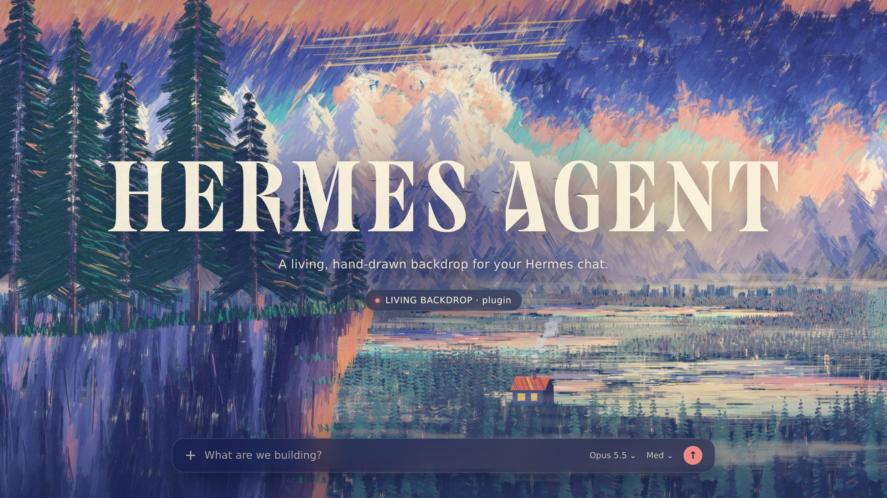
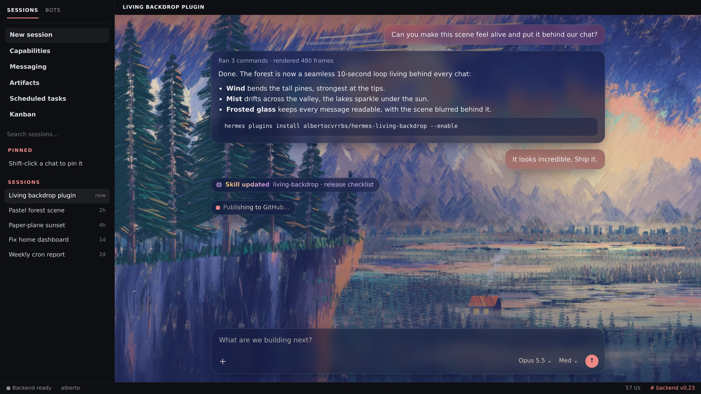

# Living Backdrop for Hermes Agent

[](https://x.com/albertocvrrbs)

An animated, hand-drawn **pastel landscape behind your [Hermes Agent](https://github.com/NousResearch/hermes-agent) chat**: pines bending in the wind, mist drifting over the valley, lakes sparkling under a 90s-anime sunset. Your messages float on top as frosted glass, so the scene stays alive without getting in the way of reading.





▶ **[Watch the 20-second demo](assets/demo.mp4)**

---

## What it does

- **A seamless 10-second loop** (1920×1080, 24 fps) behind every chat. The video downloads once and is cached in the browser, so after the first load it starts instantly.
- **Real frosted glass** on replies, your messages, and the composer. The blur is a live, blurred copy of the video clipped to each bubble. It doesn't use `backdrop-filter`, which turns off while you scroll a long thread.
- **Glass pills for the live status** (thinking, running tools, writing). When the label changes it fades into the new one instead of jumping, and ticking timers don't make it flicker.
- **Readable notes:** "Skill updated" and "Memory saved" get the same glass treatment.
- **Colours that match:** cream glass in light mode, deep indigo in dark mode, and the app accent switches to the sunset coral. Disabling the plugin restores everything.
- **Light on resources:** the video pauses when the window is hidden, and with *reduce motion* enabled you get a still frame instead.

The scene was drawn entirely in code, a few thousand crayon-like strokes on a 2D canvas, with no image models and no stock footage.

## Install

### Hermes Webapp / web dashboard

```bash
hermes plugins install albertocvrrbs/hermes-living-backdrop --enable
```

Reload the page. The Webapp loads desktop plugins from the backend's disk and copies the
`desktop/` half automatically, so nothing else is needed.

### Hermes Desktop

Run the same command on the machine that hosts the Hermes backend. If Desktop runs on that same
machine, it picks the plugin up within a few seconds (fallback: **Ctrl/Cmd+K → Reload desktop
plugins**).

If Desktop connects to a **remote** backend, the video still comes from the backend, but the desktop
half has to live on your computer. Copy `desktop/plugin.js` to:

```
<HERMES_HOME>/desktop-plugins/living-backdrop/plugin.js
```

`HERMES_HOME` defaults to `~/.hermes` on Linux and macOS, and to `%LOCALAPPDATA%\hermes` on Windows.

## Use your own loop

Replace `media/backdrop.mp4` (and optionally `media/poster.jpg`, shown blurred while the video loads)
on the backend. The cache key is the file's size and modification time, so every client downloads
the new video by itself.

For a clean loop, export one exact cycle with no duplicated frames and no audio. The encoder settings
used here:

```bash
ffmpeg -i master.mp4 -an -c:v libx264 -profile:v high -preset veryslow -tune grain \
  -crf 20 -g 48 -pix_fmt yuv420p -movflags +faststart media/backdrop.mp4
```

## How it works

| Part | Role |
|------|------|
| `dashboard/plugin_api.py` | Serves `/api/plugins/living-backdrop/meta` and `/chunk`. `ctx.rest` only speaks JSON, so the video goes out in 3 MB base64 chunks. |
| `desktop/plugin.js` | Reassembles and caches the video in IndexedDB, mounts it behind `[data-chat-surface]`, restyles the chat with scoped CSS, and runs the blur canvas and status transitions. |
| `media/` | The loop and its poster. |

The plugin only adds its own attributes and one `<style>` tag, and removes all of them when disabled.

## License

MIT. Artwork by [@albertocvrrbs](https://x.com/albertocvrrbs), free to use as your own Hermes backdrop.
